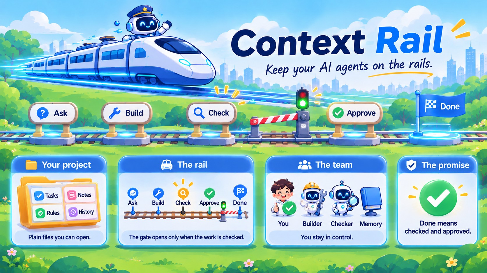

# Context Rail

[](https://pypi.org/project/context-rail/)
[](https://pypi.org/project/context-rail/)
[](https://github.com/nguyenhoanhson797/Context-Rail/actions/workflows/ci.yml)
[](https://github.com/nguyenhoanhson797/Context-Rail/blob/master/LICENSE)

**Keep your AI agents on the rails.**

AI agents are fast until they go off-script. A prompt file is a suggestion an
LLM can ignore. Context Rail turns your git repo into a file-backed workflow
engine: you declare the stages, the evidence each stage owes, the paths work
lives at, and the approvals that cannot be skipped. Your coding tool still runs
the agent; Context Rail decides what counts as done.



The problem is not model speed. It is coordination: agents forget decisions,
lose track of finished work, skip checks and change things nobody asked for.
Context Rail fixes the coordination, not the model. It plans the work, hands
each agent only what its job needs, and refuses to call anything *done* until
the declared checks pass and a separate reviewer signs off. Scope, the quality
bar and irreversible actions still wait for a human yes.

## Shape the work from declarative files

The engine is deliberately small: six primitives, eight relations, five status
categories. Everything project-specific is data.

```text
rail.yaml     The manifest  → pack name, placement templates, code-graph provider
pack.yaml     The domain    → statuses, transitions, presets, workflows, gates, actions
surface.yaml  The view      → labels, screens, card/filter/column fields
charter.md    The bar       → gates, decision rights, budgets, human-only actions
```

- **`rail.yaml` does not run agents or assign models.** It decides where each
  primitive and preset lives (`items/{preset}/{slug}.md`, for example) and which
  pack the store uses.
- **`pack.yaml` is the state machine.** It names the statuses and their
  categories, the allowed moves, the item presets and their fields, and the
  workflow whose quality rule selects a charter gate and its checks.
- **`surface.yaml` is presentation only.** It can relabel a preset or retitle a
  screen; it cannot introduce a status, a transition, an action or a permission.
  A presentation change keeps approval. A pack, placement or operating change
  moves the semantic digest and needs reapproval.
- **`charter.md` is the quality bar.** Gates (`item_done`, `scope_done`, `merge`,
  `release`), decision rights, budgets and the human-only floor live there.

Paths are derived, never supplied. An agent asks for a brief and gets the item,
the checks, the result shape and the exact path its record will take. It cannot
choose a different folder, title or schema.

## Every write passes a fail-closed pipeline

Nothing reaches the store unless it clears the same six stages:

```text
Validate → Authorize → Lock → Atomic write → Record → Index
```

A malformed pack key, an unauthorized actor, a stale etag, a missing gate or a
write outside a seat's reach **halts the write**. A refusal leaves the store
unchanged and names the command that would produce the missing proof. The SQLite
index is only a cache under the git directory; delete it and the next command
rebuilds it from the files.

## What you can build with it

- **Risk-routed changes without test overhead.** The built-in
  `adaptive-contract` pack classifies work as `trivial`, `standard` or
  `critical`. Trivial work gets a build and typecheck; standard work runs the
  existing checks; critical work adds a few boundary, failure-path and smoke
  tests, and a human records approval before the build starts. Lessons are short
  and structural changes are proposed, never auto-applied.
- **Separated builder and reviewer.** A role binds an agent to one project or
  container, with a declared reach and workspace. Role mode uses a session seat
  (or one local agent credential bound with `rail agent enable`), refuses
  `--actor`, and checks every write against that reach. The reviewer is
  a different actor; the gate refuses self-review and a same-model review when
  the charter requires another model. The code area is review evidence, not a
  sandbox: a diff outside it is a review question the reviewer must see.
- **A relay across models and tools.** State lives in Git, not chat history.
  Plan with one model, implement with another, review with a third. Each
  candidate and result can record the model and harness that produced it; the
  rail stores those facts and never chooses a model for you.
- **Non-coding state machines.** The built-in `video` pack runs
  `scene → shot → storyboard → generating → review → approved → published`.
  Copy a pack with `rail ops pack create` and declare your own vocabulary for
  research, legal drafting, publishing or any other staged process.
- **Several repositories, one queue.** The `portfolio` pack coordinates child
  stores: a master slice is gated on a child's committed, proven item, without
  writing the child store or running git on reads.

## Try it in 5 minutes

You need Python 3.11+ and git.

```bash
python -m pip install context-rail     # Windows: py -m pip install context-rail
cd your-project
rail init --pack basic                 # creates context-rail/ and asks about the project
rail change add task "Write the first task"
rail overview                          # progress, focus, blockers and the next eligible work
rail serve ui                         # the local web view
```

`rail init` writes a `context-rail/` store and asks a few questions about what
you are building. If it reports that approval is missing, approve the brief. A
named lead may sign on the human's behalf; the record names both:

```bash
rail approve charter --confirm "APPROVE charter" --confirmer "Your Name"
```

The local web view (`rail serve ui`) can sign the same approval from Health,
and an Item that needs consent asks for your own words on its sheet.

> [!NOTE]
> Working alone? `rail init --solo` binds one human as the project owner and
> skips the approval ceremony. The quality gates still apply.

### Run one governed loop

```bash
rail loop brief <task>                          # the work order: objective, checks, code area, result shape
# ... your coding tool does the work and commits ...
rail loop candidate <task> --commit <sha>       # code changes only
rail loop result <task> --body-file <result.md> --commit <sha>
rail check run <task>                           # the declared checks
rail loop review <task> --verdict approve --notes-file <review.md>
rail change move <task> done --expect <etag>
```

For research or discovery, skip `candidate` and leave the commit out of
`rail loop result`; never fabricate a commit. The result body is capped at
256 KiB, needs its ordered `##` sections, and can open with a small effort block
naming `duration_s`, `usage`, `model` and `harness`. See the
[loop skill](skills/context-rail-loop/SKILL.md) for the exact contract.

## Connect your tools

Context Rail speaks one JSON envelope over the CLI, MCP and a local web UI. It
works with Claude Code, Codex, opencode, Cursor, Gemini CLI, Droid and any MCP
client. Your harness keeps its own agents, worktrees and models.

```bash
rail serve mcp     # MCP server for your coding tool
rail serve ui      # token-protected local dashboard
```

The rail never launches an agent. It hands out the brief and records the result.

## Built-in packs

Start with a built-in pack, or copy one into your store and make it yours:

| Pack | Designed for | How work flows |
|---|---|---|
| `basic` | Getting started, small projects | todo → doing → done |
| `flow` | Continuous delivery, no sprints | backlog → ready → building → review → shipped |
| `scrum` | Teams working in sprints | goal → scope → sprint → story → task |
| `waterfall` | Projects with distinct phases | planned → designing → building → testing → done |
| `video` | Video and content production | scene → shot: storyboard → generating → review → approved → published |
| `portfolio` | Several projects coordinated from one master store | component → slice, gated by child store checks |
| `adaptive-contract` | Risk-aware code changes without test overhead | classify trivial, standard or critical → contract → build → proportionate checks → lesson |

Want your own words or steps?

```bash
rail ops pack create --name <name> --from basic
```

Edit the copy, then switch with `rail ops pack use` (human-only). Relabelling a
preset or retitling a screen never needs re-approval; changing a transition,
placement, preset or operating block does.

## Why it holds up

- **Files are the truth.** The store is Markdown, JSON records and `rail.yaml`
  in your repo. SQLite is only a cache under the git dir.
- **One write path.** CLI, MCP and UI all go through validate → authorize →
  lock → atomic write → record → index. No lost updates; every retry is safe.
- **Fail closed.** An unknown pack key, manifest schema or policy field is
  refused, never guessed.
- **Agents never read `pack.yaml`.** The compiler turns the pack into one
  model; agents ask `rail next`, `rail read show`, `rail why`, `rail explain`
  and `rail model`.
- **Project shape is data.** Sprints, phases and scenes are pack data, not
  engine code, so one engine runs any of them.
- **Your project stays yours.** Plain files, no server account, no lock-in.

## Learn more

- [How Context Rail works](https://github.com/nguyenhoanhson797/Context-Rail/blob/master/docs/how-it-works.md): architecture, operating model, commands, surfaces
- [Roles and seats](https://github.com/nguyenhoanhson797/Context-Rail/blob/master/docs/how-it-works.md#roles-and-seats): sessions, reach and the compat rule
- [The six building blocks](https://github.com/nguyenhoanhson797/Context-Rail/blob/master/docs/building-blocks.md): the visual model and two worked examples
- [User guide](https://github.com/nguyenhoanhson797/Context-Rail/blob/master/docs/context-rail-v3-guide.html): diagrams and a zero-to-daily walkthrough
- [Interactive engine graph](https://github.com/nguyenhoanhson797/Context-Rail/blob/master/docs/context-rail-v3-engine-graph.html)
- [Agent onboarding kit](https://github.com/nguyenhoanhson797/Context-Rail/blob/master/docs/agent-onboarding/README.md): set up any agent harness
- [Operator skills](https://github.com/nguyenhoanhson797/Context-Rail/blob/master/skills/README.md): drop-in skills for your agents
- [Upgrading from v1/v2](https://github.com/nguyenhoanhson797/Context-Rail/blob/master/docs/how-it-works.md#upgrading-a-v1v2-store)

The test lanes, speed budgets and working rules are in
[How Context Rail works](https://github.com/nguyenhoanhson797/Context-Rail/blob/master/docs/how-it-works.md#development)
and [AGENTS.md](https://github.com/nguyenhoanhson797/Context-Rail/blob/master/AGENTS.md).

## License

MIT License. See [LICENSE](LICENSE).
