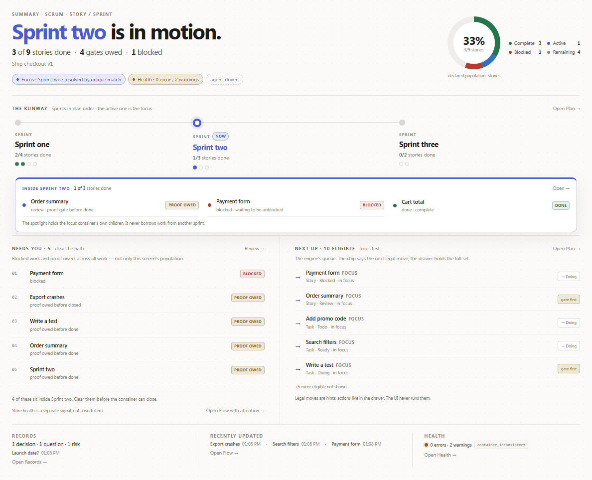
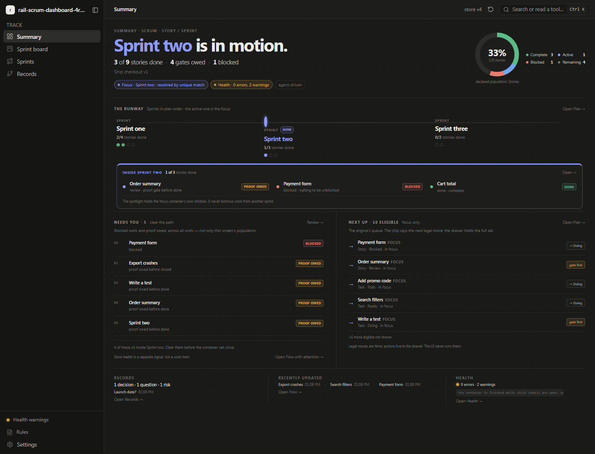

# Context Rail

[](https://pypi.org/project/context-rail/)
[](https://pypi.org/project/context-rail/)
[](https://github.com/nguyenhoanhson797/Context-Rail/actions/workflows/ci.yml)
[](https://github.com/nguyenhoanhson797/Context-Rail/blob/master/LICENSE)

**Keep your AI agents on the rails.** Context Rail turns your git repo into a
shared workspace where AI agents do the work and you stay in charge of what
matters. One source of truth, a focused brief for every agent, and a gate that
only opens when the work is proven.



Building with AI agents is fast, until it isn't. Agents forget what was decided,
lose track of what is done, skip the tests and change things nobody asked for.
The bigger the project, the worse it gets. Context Rail fixes the coordination,
not the model: it plans the work, hands each agent only what its job needs, and
refuses to call anything *done* until the checks pass and a separate reviewer
signs off. The big calls still wait for a human yes.

## What you get

- **Agents that stay focused.** Each agent gets a short, role-scoped brief built
  from your notes and the code graph — not the whole project. Less noise, fewer
  wrong turns.
- **"Done" means proven.** Work reaches done only with fresh, passing checks and
  an approved review by a different actor. When proof is missing, Context Rail
  tells you the exact command that produces it.
- **You approve what matters.** Scope, the quality bar and anything irreversible
  wait for a human. Every approval records who signed it and the human it names.
  Change the rules and Context Rail asks again.
- **Any coding tool, its own way.** Claude Code, Codex, opencode, Droid, Cursor
  or Gemini CLI does the work with its own sub-agents. Context Rail never
  launches an agent; it hands out the brief and records the result.
- **Your project stays yours.** Everything is plain Markdown and JSON in your
  repo. No server, no account, no lock-in. Delete the cache and it rebuilds.
- **One engine, any kind of project.** Kanban, sprints, phase gates or video
  production: pick a template and the same engine runs it.

## Works with the tools you already use

> **Claude Code · Codex · opencode · Cursor · Gemini CLI · Droid · any MCP client**

Context Rail is runtime-neutral. It speaks one JSON envelope over the CLI, MCP
and a local web UI, so your harness keeps its own agents, worktrees and models.
The rail records and gates; your tool does the work and you merge in git.

## Try it in 5 minutes

You need Python 3.11+ and git.

```bash
python -m pip install context-rail     # Windows: py -m pip install context-rail
cd your-project
rail init --pack basic                 # sets up the workspace and walks you through the project brief
rail change add task "Write the first task"
rail overview                          # your daily starting page
rail serve ui                          # the local web view
```

`rail init` creates a `context-rail/` folder and asks a few questions about what
you are building. If it reports that approval is missing, approve the brief — a
named lead may sign on the human's behalf, and the record names both:

```bash
rail approve charter --confirm "APPROVE charter" --confirmer "Your Name"
```

> [!NOTE]
> Working alone? `rail init --solo` skips the approval ceremony; the quality
> gates still apply.

To hand out work, run `rail loop brief` for the work order and record the result
with `rail loop result` (plus `rail loop candidate` when code changed). Your
coding tool runs the agent; Context Rail never starts it.

## See the work move



A day looks like this:

1. **See where things stand.** `rail overview` shows progress, what is next and
   what is blocked.
2. **Approve the plan.** Nothing runs until the brief is approved; the record
   says who signed it.
3. **Hand out work.** One registered item per assignment. `rail loop brief`
   gives your tool one task and a focused brief with its result shape and
   derived path.
4. **Record and prove it.** Research records `rail loop result --body-file <md>`;
   code work commits, records `rail loop candidate`, then
   `rail loop result --commit <sha>`, and runs the declared checks.
5. **Review and finish.** A different actor reviews with `rail loop review`.
   Work reaches done only with a current result, fresh checks and an approved
   review — then you merge in git.

## One engine, any kind of project

Pick a template when you start with `rail init --pack <name>`:

| Template | Best for | How work flows |
|---|---|---|
| `basic` | Getting started, small projects | todo → doing → done |
| `flow` | Work that arrives all the time, no sprints | backlog → ready → building → review → shipped |
| `scrum` | Teams that work in sprints | goal → scope → sprint → story → task |
| `waterfall` | Projects with distinct phases | planned → designing → building → testing → done |
| `video` | Video and content production | scene → shot: storyboard → generating → review → approved → published |
| `portfolio` | Several projects coordinated from one master store | component → slice, gated by child store checks |

Want your own words or steps? Copy a template and make it yours with
`rail ops pack create --name <name> --from basic`. Renaming things never needs
re-approval; changing the rules does. The whole model — six primitives, eight
relations, five status categories — is data, not engine code. See
[the six building blocks](https://github.com/nguyenhoanhson797/Context-Rail/blob/master/docs/building-blocks.md)
for the visual model and two worked examples.

## The full power

- **A code graph in every brief.** Context Rail reads your git checkout and
  builds a graph of files, functions and callers. Briefs carry a short `code
  area`; reviewers see which functions the diff changed and which tests cover
  them. `rail why src/app.py:total` answers for a symbol like it answers for an
  item. [Code graph →](https://github.com/nguyenhoanhson797/Context-Rail/blob/master/docs/how-it-works.md#code-graph)
- **Roles and seats.** Declare a lead, implementers and reviewers; bind each
  agent to a seat on the project or one container. A seat sees only its subtree
  and every write is checked against the same reach. [Roles and seats →](https://github.com/nguyenhoanhson797/Context-Rail/blob/master/docs/how-it-works.md#roles-and-seats)
- **Several projects, one master store.** Coordinate repositories that must land
  together with the `portfolio` pack: each child keeps its own store, and the
  master gates slices on the child's committed, proven work. [Several projects →](https://github.com/nguyenhoanhson797/Context-Rail/blob/master/docs/how-it-works.md#several-projects)
- **Three surfaces, one answer.** The `rail` CLI, `rail serve mcp` for any MCP
  client, and `rail serve ui` for a token-protected local web view all read the
  same compiled model. A small background helper keeps commands fast and stops
  itself after 10 idle minutes.

## Why it holds up

- **Files are the truth.** The store is Markdown, JSON records and `rail.yaml`
  in your repo. SQLite is only a cache under the git dir.
- **One write path.** CLI, MCP and UI all go through validate → authorize →
  lock → atomic write → record → index. No lost updates; every retry is safe.
- **Fail closed.** An unknown pack key, manifest schema or policy field is
  refused, never guessed.
- **Agents never read `pack.yaml`.** A compiler turns the pack into one model;
  agents ask `rail next`, `rail read show`, `rail why` and `rail model`.
- **Project shape is data.** Sprints, phases and scenes are pack data, not
  engine code — so one engine runs any of them.

## Learn more

- [How Context Rail works](https://github.com/nguyenhoanhson797/Context-Rail/blob/master/docs/how-it-works.md): architecture, operating model, commands, surfaces
- [The six building blocks](https://github.com/nguyenhoanhson797/Context-Rail/blob/master/docs/building-blocks.md): the visual model and two worked examples
- [User guide](https://github.com/nguyenhoanhson797/Context-Rail/blob/master/docs/context-rail-v3-guide.html): diagrams and a zero-to-daily walkthrough
- [Interactive engine graph](https://github.com/nguyenhoanhson797/Context-Rail/blob/master/docs/context-rail-v3-engine-graph.html)
- [Agent onboarding kit](https://github.com/nguyenhoanhson797/Context-Rail/blob/master/docs/agent-onboarding/README.md): set up any agent harness
- [Operator skills](https://github.com/nguyenhoanhson797/Context-Rail/blob/master/skills/README.md): drop-in skills for your agents
- [Upgrading from v1/v2](https://github.com/nguyenhoanhson797/Context-Rail/blob/master/docs/how-it-works.md#upgrading-a-v1v2-store)

The test lanes, speed budgets and working rules are in
[How Context Rail works](https://github.com/nguyenhoanhson797/Context-Rail/blob/master/docs/how-it-works.md#development)
and [AGENTS.md](https://github.com/nguyenhoanhson797/Context-Rail/blob/master/AGENTS.md).