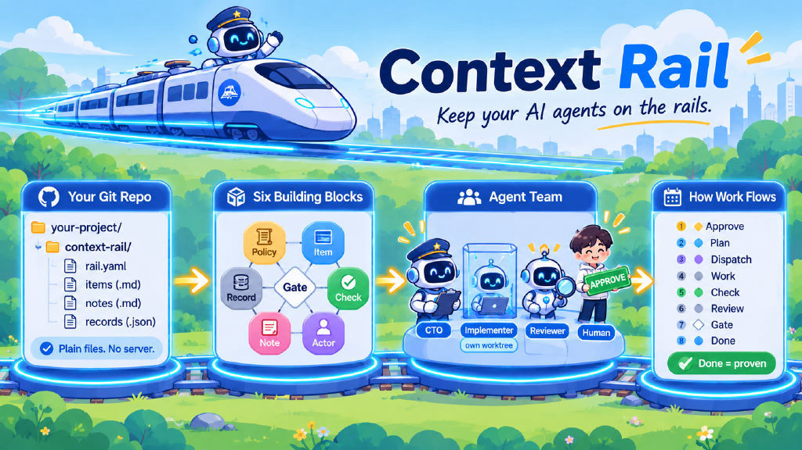
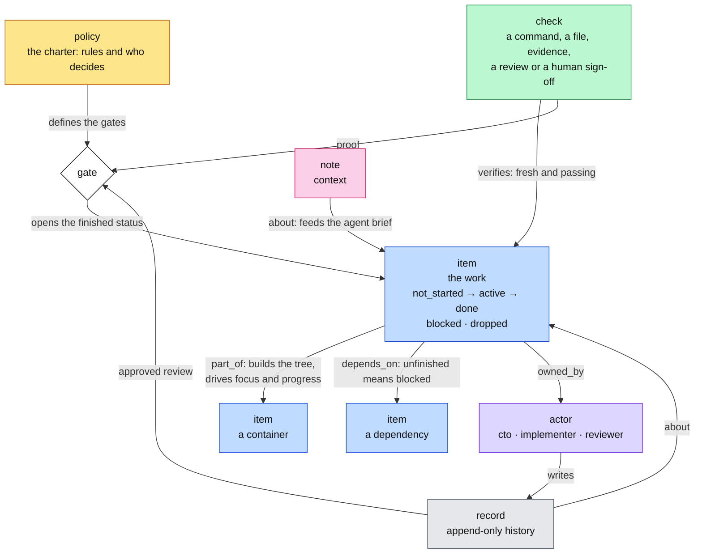
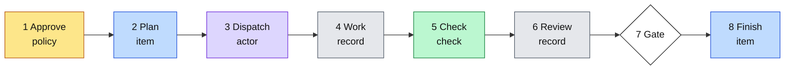
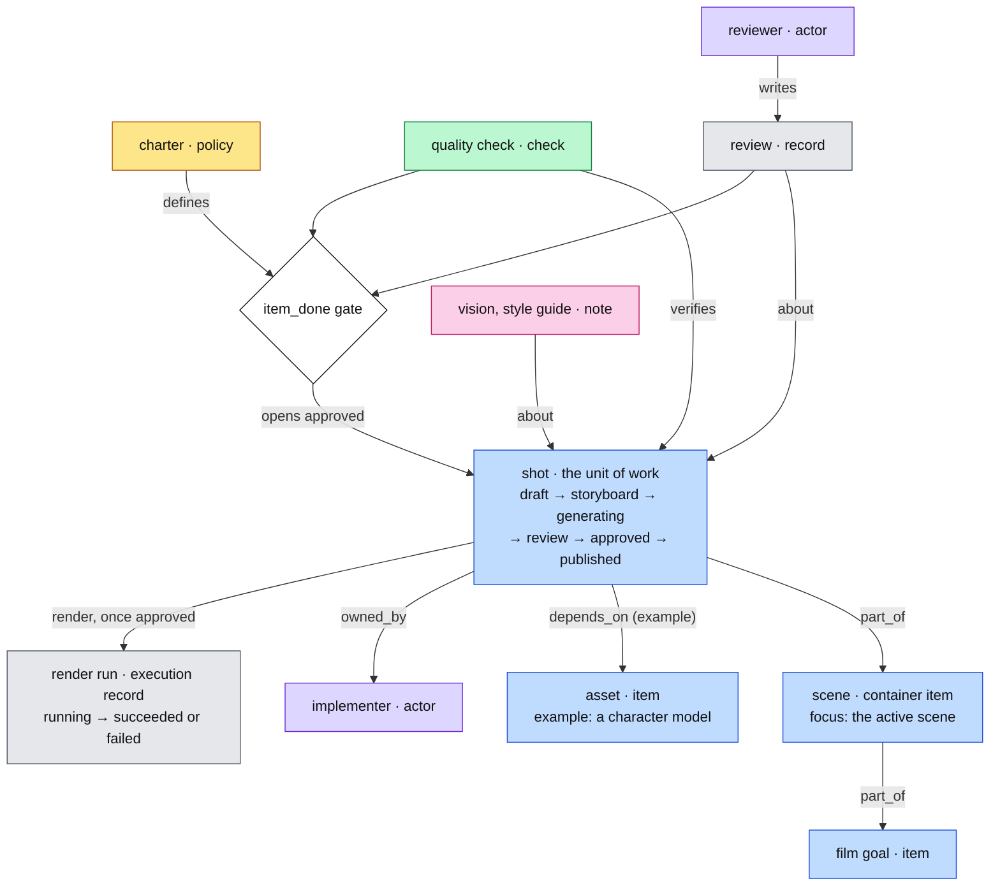
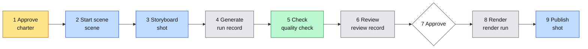
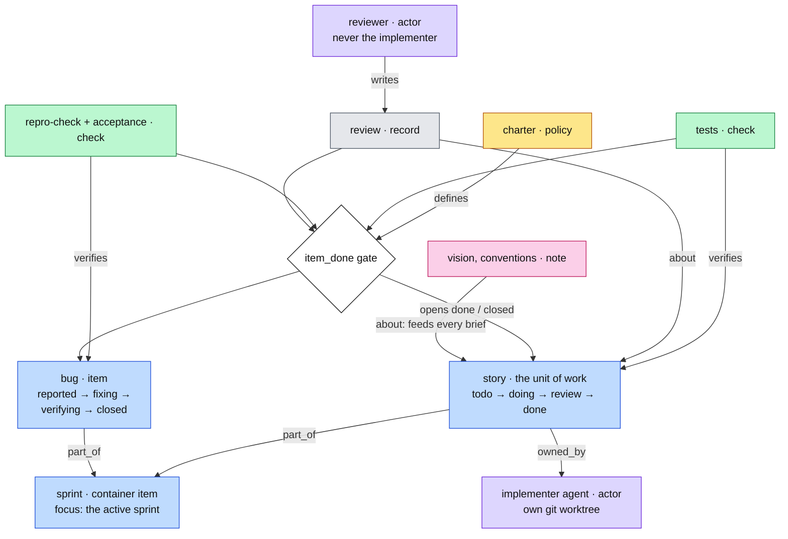

# Context Rail

[](https://pypi.org/project/context-rail/)
[](https://pypi.org/project/context-rail/)
[](https://github.com/nguyenhoanhson797/Context-Rail/blob/master/LICENSE)



**Keep your AI agents on the rails.** Context Rail turns your project into a
shared workspace where AI agents do the work and you stay in charge of what
matters.

Building with AI agents is fast, until it isn't. Agents forget what was
decided, lose track of what is done, skip the tests and change things nobody
asked for. The bigger the project, the worse it gets.

Context Rail gives every project one source of truth that lives in your git
repo. A lead agent plans and hands out the work. Each helper agent sees only
what its job needs. Nothing counts as done until it is proven, and the big
calls wait for a human yes.

## What you get

- **Agents that stay focused.** Each agent gets a short brief for its role
  instead of the whole project. Less noise, fewer wrong turns.
- **You approve what matters.** The project's scope, its quality bar and
  anything irreversible wait for a human. Change the rules, and Context Rail
  asks again.
- **"Done" means proven.** Work only reaches done when its checks pass. When
  proof is missing, Context Rail tells you which command produces it.
- **Every agent works in its own sandbox.** Each job runs in a separate git
  worktree and lands only after review, as a clean fast-forward merge.
- **Your project stays yours.** Everything is plain Markdown and JSON in your
  repo. No server, no account, no lock-in.
- **One tool for any kind of project.** Kanban, sprints, phase gates or video
  production: pick a template and the same engine runs it.

## Try it in 5 minutes

You need Python 3.11+ and git.

```bash
python -m pip install context-rail     # Windows: py -m pip install context-rail
cd your-project
rail init --pack basic                 # sets up the workspace and walks you through the project brief
rail change add task "Write the first task"
rail overview                          # your daily starting page
rail serve ui                          # the local web view
```

`rail init` creates a `context-rail/` folder in your project and asks a few
questions about what you are building. If it reports that approval is missing,
approve the brief yourself:

```bash
rail --actor human approve charter --confirm "APPROVE charter" --confirmer "Your Name"
```

To let agents pick up the work, install the Factory `droid` CLI (or point
`RAIL_DROID_BIN` at it).

## How a day looks

1. **See where things stand.** `rail overview` shows progress, what is next
   and what is blocked.
2. **Approve the plan.** Nothing runs until a human approves the brief.
   Working alone? Solo mode skips the ceremony; the quality checks still apply.
3. **Hand out work.** `rail loop dispatch` gives an agent one task, a focused
   brief and its own sandbox.
4. **Prove it.** The checks you chose run against the agent's work.
5. **Review and merge.** A different actor reviews, and `rail loop merge`
   lands only approved work.

## Works for any kind of project

Pick a template when you start with `rail init --pack <name>`:

| Template | Best for | How work flows |
|---|---|---|
| `basic` | Getting started, small projects | todo → doing → done |
| `flow` | Work that arrives all the time, no sprints | backlog → ready → building → review → shipped |
| `scrum` | Teams that work in sprints | goal → scope → sprint → story → task |
| `waterfall` | Projects with distinct phases | planned → designing → building → testing → done |
| `video` | Video and content production | scene → shot, each shot: storyboard → generating → review → approved → published |

Want your own words or steps? Copy a template and make it yours with
`rail ops pack create --name <name> --from basic`. Renaming things never needs
re-approval; changing the rules does.

## Build any project from six building blocks

Every Context Rail project, whatever its shape, is built from the same six
building blocks. The engine knows only these; a template gives them the names
your team already uses. Each section below shows two pictures: how the blocks
relate, and how a project runs through them. Colors are the same everywhere:
yellow policy, blue item, green check, gray record, pink note, purple actor.

### How the blocks relate



The **policy** decides which gates exist. A **gate** keeps an **item** out of
its finished status until its **checks** pass and a review **record** approves
it. An unfinished `depends_on` blocks the item, and `part_of` builds the tree
that decides focus and progress. **Notes** give agents their context, and
**records** keep the history.

### How a project runs



1. A human approves the charter; nothing runs before that.
2. The CTO agent plans work under the container in focus.
3. An implementer agent gets one item, a brief built from notes, and its own git worktree.
4. The run is written down as a record.
5. The item's checks run in that worktree. A failed run gets one retry, then escalates to you.
6. A different actor reviews the work.
7. The gate opens only with fresh, passing checks and an approved review.
8. The item finishes, the work merges as a fast-forward, and progress updates in your daily digest.

### Example: a video production





The shot is the unit of work, and the scene in production is the focus. A shot
reaches approved only through the `item_done` gate. Progress counts approved
shots per scene; render runs show up as execution progress and never count as
finished work.

### Example: vibe coding in sprints

```mermaid
flowchart LR
    Q1["1 Approve<br/>charter"] --> Q2["2 Start sprint<br/>sprint"] --> Q3["3 Plan<br/>story"] --> Q4["4 Build<br/>run record"] --> Q5["5 Test<br/>tests"] --> Q6["6 Review<br/>review record"] --> Q7{"7 Gate"} --> Q8["8 Merge<br/>story done"] --> Q9["9 Close sprint<br/>sprint"]

    classDef cPolicy fill:#fde68a,stroke:#b45309,color:#111
    classDef cItem fill:#bfdbfe,stroke:#1d4ed8,color:#111
    classDef cCheck fill:#bbf7d0,stroke:#15803d,color:#111
    classDef cRecord fill:#e5e7eb,stroke:#4b5563,color:#111
    classDef cNote fill:#fbcfe8,stroke:#be185d,color:#111
    classDef cActor fill:#ddd6fe,stroke:#6d28d9,color:#111
    classDef cGate fill:#fff,stroke:#111,color:#111
    class Q1 cPolicy
    class Q2,Q3,Q8,Q9 cItem
    class Q4,Q6 cRecord
    class Q5 cCheck
    class Q7 cGate
```





The story is the unit of work, and the running sprint is the focus. A story
reaches done only with passing tests and an approved review; a bug also needs
its `repro-check` and `acceptance` checks before it closes. A sprint closes only
when every story in it is finished, and progress counts finished stories per
sprint.

## Code graph

For code projects, Context Rail reads your git checkout and builds a graph of
files, functions and who calls whom. It lives in a local cache, not in the
store, and rebuilds from git. When you dispatch an agent, the work order
carries a short `code area`: the files and symbols the item mentions, plus their
callers. At review, the reviewer sees which functions the diff changed, what
reaches them, and which tests cover them. `rail why src/app.py:total` answers
for a file or a function the same way it answers for an item.

```bash
rail ops codegraph setup     # check the provider and build the first snapshot
rail ops codegraph status    # provider, coverage and freshness
```

It is on by default for code packs and off for the video pack. Choose a
provider in `rail.yaml`:

```yaml
code_graph: builtin      # builtin | graphify | gitnexus | none
```

or pass `--code-graph graphify` (or `gitnexus`, `builtin`, `none`) to
`rail init`. For an external provider, init runs a readiness probe once and
reports the line at the end; it does not build a snapshot, and a missing tool
does not fail the init. Run `rail ops codegraph setup` for the first build.

`builtin` needs no install. `graphify` (`uv tool install "graphifyy>=0.9.100,<0.10"`,
Apache-2.0) and `gitnexus` (`npm install -g gitnexus`, Node 22.18+ or 24.11+,
PolyForm Noncommercial) are optional upgrades. Override a binary with
`RAIL_GRAPHIFY_BIN` or `RAIL_GITNEXUS_BIN`. A store made before the code graph,
with hand-written `code` notes, moves over once with
`rail --actor human ops codegraph adopt`; it rewrites only the profiles and
skills you have not edited.

The rail never installs an external tool. If the configured tool is missing or
broken, dispatch falls back to `builtin` and says why in the work order.
`rail ops codegraph setup` caches its readiness check; `status`, the overview,
approval and `rail ops doctor` read that cache without starting a process.
GitNexus is indexed in an isolated mirror under the local cache, so it never
writes `.gitnexus`, `.claude` or a GitNexus section into your checkout, and
`GITNEXUS_HOME` keeps its registry out of your home directory.

## Use it your way

- **Command line.** `rail` works for you and your agents alike. Every answer
  is one JSON reply that agents read easily.
- **Any MCP client.** `rail serve mcp` plugs Context Rail into AI tools that
  speak MCP.
- **Local web UI.** `rail serve ui` shows Flow, Plan and Records views. It runs
  on your machine only and is protected by a token.
- **Quick by default.** A small background helper keeps everyday commands fast
  and stops itself after 10 idle minutes.

## For engineers

- **Files are the truth.** The store is Markdown, JSON records and `rail.yaml`
  in your repo. SQLite is only a cache under the git dir; delete it and the
  next command rebuilds it.
- **One write path.** CLI, MCP and UI all go through validate → authorize →
  lock → atomic write → record → index.
- **Fail closed.** An unknown pack key, manifest schema or policy field is
  refused, never guessed.
- **Agents never read `pack.yaml`.** A compiler turns the pack into one model,
  and agents ask `rail next`, `rail read show`, `rail why` and `rail model`.
- **No lost updates, safe retries.** Every write carries the etag it read, and
  every retry carries an idempotency key that returns the same record.
- **Project shape is data.** Six primitives, eight relations and five status
  categories are fixed; sprints, phases and scenes are pack data, not engine
  code.

The full picture, with the architecture, the operating model and every
command, is in
[How Context Rail works](https://github.com/nguyenhoanhson797/Context-Rail/blob/master/docs/how-it-works.md).

## Learn more

- [How Context Rail works](https://github.com/nguyenhoanhson797/Context-Rail/blob/master/docs/how-it-works.md): architecture, operating model, commands, surfaces
- [User guide](https://github.com/nguyenhoanhson797/Context-Rail/blob/master/docs/context-rail-v3-guide.html): diagrams and a zero-to-daily walkthrough
- [Interactive engine graph](https://github.com/nguyenhoanhson797/Context-Rail/blob/master/docs/context-rail-v3-engine-graph.html)
- [Agent onboarding kit](https://github.com/nguyenhoanhson797/Context-Rail/blob/master/docs/agent-onboarding/README.md): set up any agent harness
- [Operator skills](https://github.com/nguyenhoanhson797/Context-Rail/blob/master/skills/README.md): drop-in skills for your agents
- [Upgrading from v1/v2](https://github.com/nguyenhoanhson797/Context-Rail/blob/master/docs/how-it-works.md#upgrading-a-v1v2-store)

## Contributing

```bash
python -m pip install -e .[test]
python -m pytest -q -m "not slow and not perf"
```

The test lanes, speed budgets and working rules are in
[How Context Rail works](https://github.com/nguyenhoanhson797/Context-Rail/blob/master/docs/how-it-works.md#development)
and [AGENTS.md](https://github.com/nguyenhoanhson797/Context-Rail/blob/master/AGENTS.md).

## License

MIT. See [LICENSE](https://github.com/nguyenhoanhson797/Context-Rail/blob/master/LICENSE).
