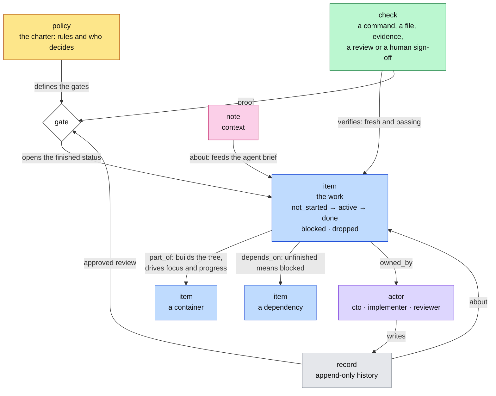
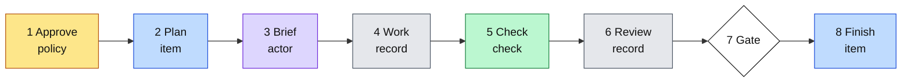
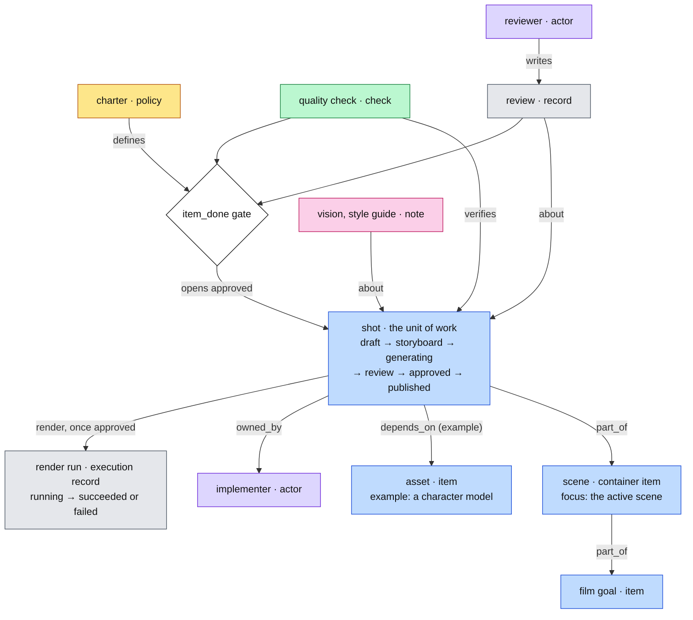
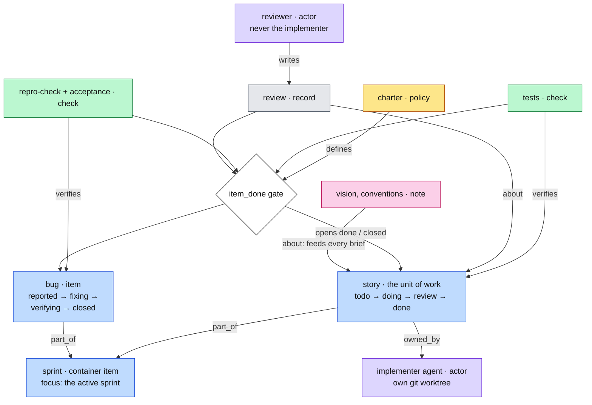

# The six building blocks

Every Context Rail project, whatever its shape, is built from the same six
primitives. This page is the visual model: how the blocks relate, how a
project runs through them, and two worked examples. For the engineering
guarantees behind them, see [How Context Rail works](how-it-works.md).

## Build any project from six building blocks

Every Context Rail project, whatever its shape, is built from the same six
building blocks. The engine knows only these; a template gives them the names
your team already uses. Each section below shows two pictures: how the blocks
relate, and how a project runs through them. Colors are the same everywhere:
yellow policy, blue item, green check, gray record, pink note, purple actor.

### How the blocks relate

The **policy** decides which gates exist. A **gate** keeps an **item** out of
its finished status until its **checks** pass and a review **record** approves
it. An unfinished `depends_on` blocks the item, and `part_of` builds the tree
that decides focus and progress. **Notes** give agents their context, and
**records** keep the history.

### How a project runs

1. The charter is approved; nothing runs before that. A human signs by default,
   or a named lead signs on the human's behalf when the charter allows it.
2. The CTO agent plans work under the container in focus.
3. An implementer agent, started by your own tool, gets one item and a brief built from notes.
4. Its commit is written down as a candidate record, and the work is written
   down as a Markdown result record. The result may open with an effort block
   (`duration_s`, `usage: {tokens: ..., requests: ...}`, `model`, `harness`);
   commitless research records only the result.
5. The item's checks run on that commit. A failed check means a new commit and a new candidate.
6. A different actor reviews the work.
7. The gate opens only with fresh, passing checks and an approved review.
8. The item finishes, you merge in git, and progress updates in your daily digest.

### Example: a video production

```mermaid
flowchart LR
    V1["1 Approve<br/>charter"] --> V2["2 Start scene<br/>scene"] --> V3["3 Storyboard<br/>shot"] --> V4["4 Generate<br/>execution record"] --> V5["5 Check<br/>quality check"] --> V6["6 Review<br/>review record"] --> V7{"7 Approve"} --> V8["8 Render<br/>render run"] --> V9["9 Publish<br/>shot"]

    classDef cPolicy fill:#fde68a,stroke:#b45309,color:#111
    classDef cItem fill:#bfdbfe,stroke:#1d4ed8,color:#111
    classDef cCheck fill:#bbf7d0,stroke:#15803d,color:#111
    classDef cRecord fill:#e5e7eb,stroke:#4b5563,color:#111
    classDef cNote fill:#fbcfe8,stroke:#be185d,color:#111
    classDef cActor fill:#ddd6fe,stroke:#6d28d9,color:#111
    classDef cGate fill:#fff,stroke:#111,color:#111
    class V1 cPolicy
    class V2,V3,V9 cItem
    class V4,V6,V8 cRecord
    class V5 cCheck
    class V7 cGate
```

The shot is the unit of work, and the scene in production is the focus. A shot
reaches approved only through the `item_done` gate. Progress counts approved
shots per scene; render runs show up as execution progress and never count as
finished work.

### Example: vibe coding in sprints

```mermaid
flowchart LR
    Q1["1 Approve<br/>charter"] --> Q2["2 Start sprint<br/>sprint"] --> Q3["3 Plan<br/>story"] --> Q4["4 Build<br/>candidate record"] --> Q5["5 Test<br/>tests"] --> Q6["6 Review<br/>review record"] --> Q7{"7 Gate"} --> Q8["8 Finish<br/>story done"] --> Q9["9 Close sprint<br/>sprint"]

    classDef cPolicy fill:#fde68a,stroke:#b45309,color:#111
    classDef cItem fill:#bfdbfe,stroke:#1d4ed8,color:#111
    classDef cCheck fill:#bbf7d0,stroke:#15803d,color:#111
    classDef cRecord fill:#e5e7eb,stroke:#4b5563,color:#111
    classDef cNote fill:#fbcfe8,stroke:#be185d,color:#111
    classDef cActor fill:#ddd6fe,stroke:#6d28d9,color:#111
    classDef cGate fill:#fff,stroke:#111,color:#111
    class Q1 cPolicy
    class Q2,Q3,Q8,Q9 cItem
    class Q4,Q6 cRecord
    class Q5 cCheck
    class Q7 cGate
```

The story is the unit of work, and the running sprint is the focus. A story
reaches done only with passing tests and an approved review; a bug also needs
its `repro-check` and `acceptance` checks before it closes. A sprint closes only
when every story in it is finished, and progress counts finished stories per
sprint.
